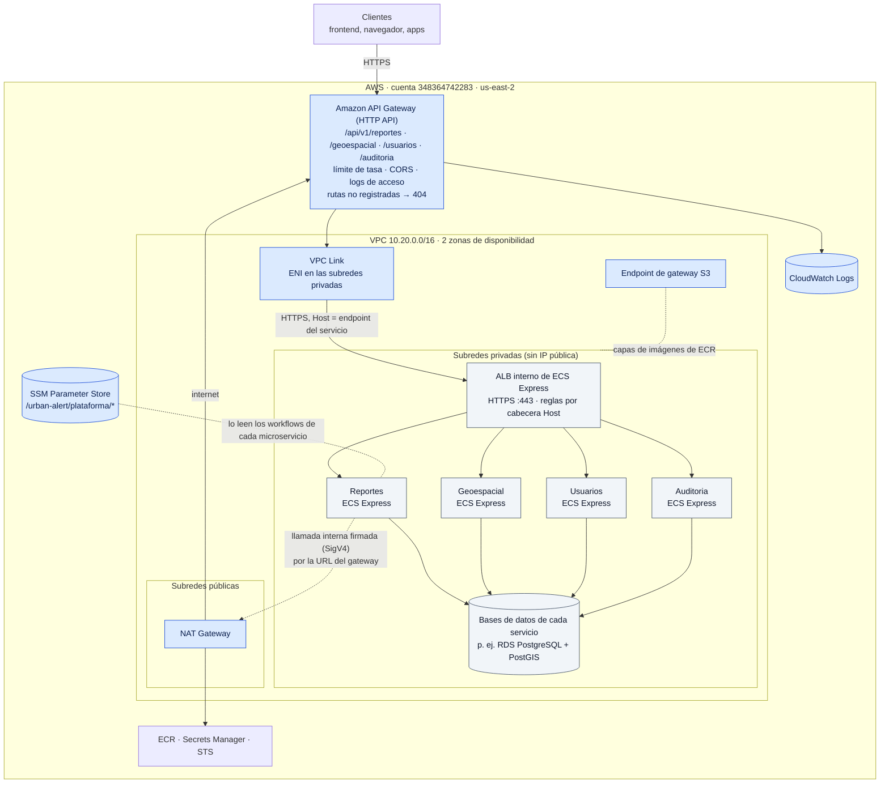

# UrbanAlert — Plataforma compartida en AWS

Infraestructura común a todos los microservicios de UrbanAlert, gestionada con Terraform desde GitHub Actions:

- **Red**: VPC propia con subredes privadas en 2 zonas y salida a internet por un NAT Gateway gestionado.
- **Amazon API Gateway** (HTTP API): la única entrada pública. Cada microservicio registra sus rutas y solo es accesible a través de él.

Cuenta `348364742283`, región `us-east-2`. Spec, plan y decisiones en [specs/001-red-api-gateway](specs/001-red-api-gateway/).

## Arquitectura

### UrbanAlert en AWS

Así reemplaza AWS a la infraestructura local (`UrbanAlert/infrastructure`: Nginx como gateway, redes de Docker y un túnel de Cloudflare). Este repo crea las piezas azules; cada microservicio crea las suyas desde su propio repo.



| Local (`UrbanAlert/infrastructure`) | AWS |
|---|---|
| Gateway Nginx en `localhost:8080` (único puerto publicado) | Amazon API Gateway compartido: la única URL pública, solo HTTPS |
| Rutas `/api/v1/<servicio>/...` reescritas hacia cada servicio | Las mismas rutas: cada microservicio registra sus integraciones, con reescritura de ruta (`overwrite:path`) |
| Cabecera `X-Urban-Gateway-Key` añadida hacia Auditoria | Cabecera fija en la integración de Auditoria |
| Red `backend` de Docker; los servicios se llaman entre sí directamente | Los servicios se llaman entre sí **por el gateway**; las rutas internas (p. ej. la asignación de coordenadas) exigen firma IAM con el rol de tarea |
| Redes `data-*`: cada API solo alcanza su base de datos | Bases de datos en las subredes privadas, con un grupo de seguridad que solo admite las tareas de su servicio (se crean en el repo de cada servicio) |
| Túnel de Cloudflare para publicar la demo | No hace falta: el gateway ya es público |
| Frontend servido por el gateway en `/` | Fuera de esta plataforma: el frontend tendrá su propia URL y llamará al gateway (CORS) |

Estado: la plataforma se define y aprovisiona con la spec 001. Los microservicios se integran uno a uno; el primero es [urban-alert-geoespacial](https://github.com/Unal-Team-C/urban-alert-geoespacial). La mensajería entre servicios (en local, RabbitMQ entre Reportes y Auditoria) y la autenticación en el gateway quedan para features posteriores.

### Detalle de la plataforma

```text
 Internet ──HTTPS──► API Gateway (HTTP API, stage $default: límite de tasa, logs de acceso, CORS)
                       │  rutas /api/v1/<servicio>/... registradas por cada microservicio
                       ▼
                 VPC Link ── HTTPS (Host = endpoint del servicio) ──┐
 ┌──── VPC 10.20.0.0/16 ─────────────────────────────────────────────▼──────────┐
 │  subredes privadas /20 (2 zonas): ALB interno de ECS Express + tareas Fargate │
 │        │ salida 0.0.0.0/0                                                     │
 │        ▼                                                                      │
 │  subred pública /24: NAT Gateway ─► IGW ─► internet (ECR, logs, secretos,     │
 │                                             URL del gateway)                  │
 │  endpoint de gateway S3 (capas de ECR sin pasar por el NAT)                   │
 └───────────────────────────────────────────────────────────────────────────────┘
 SSM /urban-alert/plataforma/* ──► workflows de los microservicios
```

| Pieza | Dónde |
|---|---|
| VPC, subredes, IGW, grupo de seguridad por defecto sin reglas | [`infra/plataforma/network.tf`](infra/plataforma/network.tf) |
| NAT Gateway (uno, o uno por zona con `nat_por_zona`), endpoint de S3 | [`infra/plataforma/egress.tf`](infra/plataforma/egress.tf) |
| HTTP API, stage, VPC Link y su grupo de seguridad | [`infra/plataforma/gateway.tf`](infra/plataforma/gateway.tf), [`logs.tf`](infra/plataforma/logs.tf) |
| Contrato con los microservicios (parámetros SSM) | [`infra/plataforma/ssm.tf`](infra/plataforma/ssm.tf) |
| Ejemplo de integración de un microservicio | [`infra/ejemplo-consumidor/`](infra/ejemplo-consumidor/) |
| Guía de integración | [`docs/integracion.md`](docs/integracion.md) |

## Contrato para los microservicios

Parámetros SSM (estándar, `String` salvo indicación). Sus nombres no cambian sin coordinarlo con los consumidores (constitución P9).

| Parámetro | Valor |
|---|---|
| `/urban-alert/plataforma/region` | `us-east-2` |
| `/urban-alert/plataforma/vpc-id` | ID de la VPC |
| `/urban-alert/plataforma/vpc-cidr` | `10.20.0.0/16` |
| `/urban-alert/plataforma/subredes-privadas` | `StringList` con las subredes privadas, en orden de zona |
| `/urban-alert/plataforma/api-id` | ID de la HTTP API |
| `/urban-alert/plataforma/api-endpoint` | URL pública del gateway (`https://<api-id>.execute-api.us-east-2.amazonaws.com`) |
| `/urban-alert/plataforma/api-execution-arn` | Para conceder `execute-api:Invoke` sobre rutas internas |
| `/urban-alert/plataforma/vpc-link-id` | VPC Link hacia los ALB internos de Express |
| `/urban-alert/plataforma/vpc-link-sg-id` | Grupo de seguridad del VPC Link |

Cómo desplegar un microservicio y registrar sus rutas (incluido el enrutamiento por cabecera `Host` del ALB de Express y las rutas internas con firma IAM): **[docs/integracion.md](docs/integracion.md)**.

## Workflows

| Workflow | Cuándo | Qué hace |
|---|---|---|
| [Provision](.github/workflows/provision.yml) | Cada push a `main` | Comprobaciones (`fmt`, `validate`, `terraform test`, pruebas de scripts, actionlint, shellcheck) → `plan` → [guarda](scripts/guard-plan.sh) → `apply` → [prueba de humo](scripts/smoke-gateway.sh) → resumen con las salidas |
| [Deprovision](.github/workflows/deprovision.yml) | Solo a mano | Exige confirmación → [comprueba dependientes](scripts/check-dependents.sh) → `destroy` |

Los dos comparten el grupo de `concurrency` `urban-alert-plataforma`: nunca se ejecutan a la vez.

- **Guarda contra reemplazos**: si un cambio elimina o reemplaza la VPC, las subredes privadas, el gateway, su stage, el VPC Link o los parámetros SSM, Provision falla antes de aplicar. Si es intencionado, pon `permitir_reemplazo_compartido = true` en [`terraform.tfvars`](infra/plataforma/terraform.tfvars) en un commit, y vuelve a ponerlo en `false` después. Los consumidores tendrán que volver a desplegarse.
- **Desaprovisionar**: primero cada microservicio (su propio Deprovision) y **después** la plataforma. En GitHub: Actions → Deprovision → Run workflow → escribir `urban-alert-plataforma`. Si queda algo en uso (grupos de seguridad, ALB o interfaces de red en la VPC, rutas o integraciones en el gateway), no elimina nada y lo lista. Un push a `main` recrea la plataforma; los IDs cambian y los consumidores los toman de SSM.

## Costes

Estimación mensual en `us-east-2` con la plataforma encendida y sin tráfico (730 h):

| Recurso | Precio | Mes |
|---|---|---|
| NAT Gateway (1) | 0,045 USD/h + 0,045 USD/GB procesado | ~32,9 USD |
| IPv4 pública (IP elástica del NAT) | 0,005 USD/h | ~3,7 USD |
| HTTP API | 1 USD por millón de peticiones | ~0 |
| VPC Link | sin cargo | 0 |
| Endpoint de gateway S3 | sin cargo | 0 |
| Parámetros SSM estándar | sin cargo | 0 |
| CloudWatch Logs (30 días) | 0,50 USD/GB ingerido + 0,03 USD/GB-mes | ~0 |
| **Total** | | **~36,6 USD** |

- Con `nat_por_zona = true` el NAT y su IP se duplican: unos 73 USD al mes.
- No incluye el **ALB interno que crea ECS Express**: unos 16–20 USD al mes, compartido por hasta 25 servicios. Lo crea el primer microservicio que se despliega y lo elimina Express cuando no queda ninguno.
- Para no pagar cuando no se usa: desaprovisionar (primero los microservicios).

## Arranque (una sola vez)

Los recursos que Terraform necesita para ejecutarse se crean a mano: el proveedor OIDC, el rol de los workflows y su política de la plataforma, el bucket del estado, y el secreto y la variable de GitHub. Pasos en **[infra/bootstrap/README.md](infra/bootstrap/README.md)**. Estado de Terraform: `s3://urban-alert-tfstate-348364742283/plataforma/terraform.tfstate`.

## Validación local (sin instalar nada)

Con Podman (`podman machine start`), desde la raíz del repo:

```bash
TF='podman run --rm -v "$PWD":/w -w /w docker.io/hashicorp/terraform:1.16.5'
eval "$TF -chdir=infra/plataforma init -backend=false" && eval "$TF -chdir=infra/plataforma test"
eval "$TF -chdir=infra/ejemplo-consumidor init -backend=false" && eval "$TF -chdir=infra/ejemplo-consumidor test"
eval "$TF fmt -check -recursive infra"
bash scripts/tests/run.sh
podman run --rm -v "$PWD":/repo -w /repo docker.io/rhysd/actionlint:1.7.7
podman run --rm -v "$PWD":/mnt -w /mnt docker.io/koalaman/shellcheck:v0.10.0 scripts/*.sh scripts/tests/*.sh
```

`apply`, `plan` contra el estado real y `destroy` solo se ejecutan desde los workflows (constitución P1).

## Desarrollo con SDD

Se desarrolla con **desarrollo guiado por especificaciones (SDD)** usando Claude Code y un arnés con persistencia en disco. Las features van en `specs/NNN-nombre/`.

- Guía de uso: [.sdd/GUIA.md](.sdd/GUIA.md) · Referencia: [.sdd/README.md](.sdd/README.md) · Protocolo: [.sdd/PROTOCOL.md](.sdd/PROTOCOL.md)
